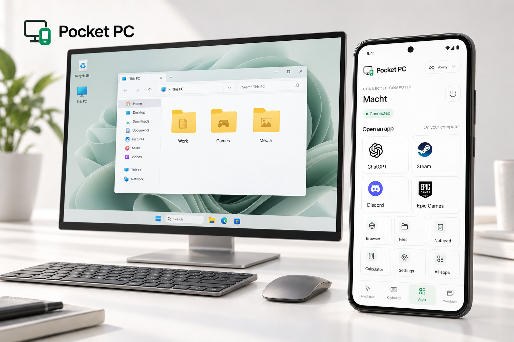
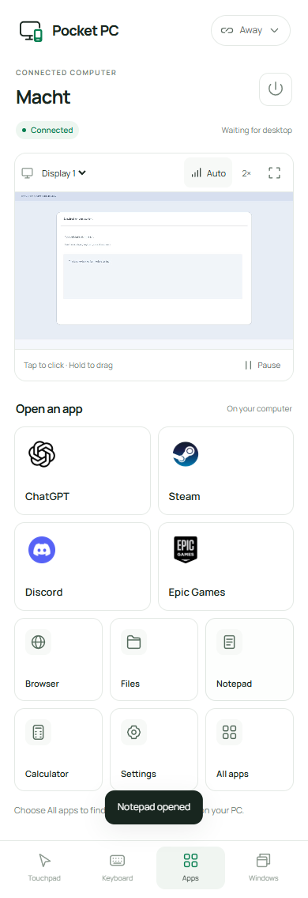
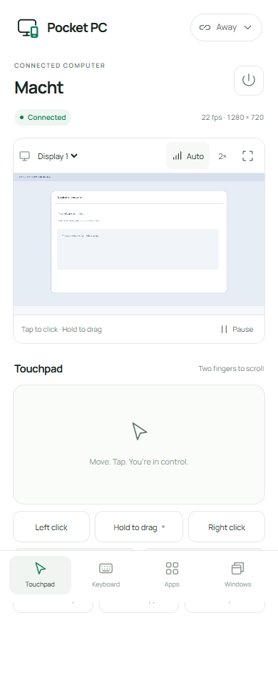

# Pocket PC — Your desktop, within reach

> Portfolio showcase only. The application source, personal APK, deployment configuration, and credentials are private. This repository contains a project description and preview images.

Pocket PC is a **Windows + Android remote-control prototype** I built to make small PC tasks manageable from a phone: open an app, type a message, switch a window, or check something on the desktop while away from the desk.

[View the portfolio project](https://mxcht.xyz/#pocketpc)

## The experience

The Android interface has a quiet white theme, clear typography, and small green status accents. A live desktop view sits alongside touchpad, keyboard, app, and window controls. ChatGPT, Steam, Discord, and Epic Games have recognizable shortcut tiles that launch the apps on the PC.

On Windows, a simple companion makes sharing visible: Start, Stop, keep the PC awake while sharing, or reset the paired phone. Home mode connects on the local network; Away mode uses a separately hosted relay.

## What I built

- A Windows capture and input host, plus the desktop companion.
- An Android interface with direct touch, touchpad gestures, scrolling, dragging, Unicode typing, and keyboard shortcuts.
- App launch shortcuts and window switching, minimising, and close requests.
- H.264 streaming where supported, JPEG fallback, frame acknowledgements, and Auto, Smooth, Sharp, and Data saver modes.
- One-phone pairing with an Android Keystore identity, a pinned PC TLS connection, and a relay path for away access.

## Interface previews

### App shortcuts

### Desktop controls

These interface captures use the actual v0.4.2 web UI with an isolated fake desktop and demo content. They contain no personal desktop data and are not physical-phone screenshots. The studio hero is an AI-assisted product visualization; its monitor scene illustrates everyday PC use.

## Tools

Python · aiohttp · Java / Android · WebView · PyAV / H.264 · Cloudflare Workers

## Status

**Private beta.** This is a portfolio case study rather than a public download or an open-source release. The personal APK is tied to one PC. A signed installer, generic customer pairing, wider device and mobile-data testing, and an independent security review remain future work.

The prototype does not provide remote Windows sign-in/unlock, secure UAC desktop control, audio, or file transfer. Stream quality depends on the PC, phone, and network.

## Ownership

Built by [Soufiane Macht](https://mxcht.xyz/). See [COPYRIGHT.md](COPYRIGHT.md). The featured app marks belong to their respective owners.
